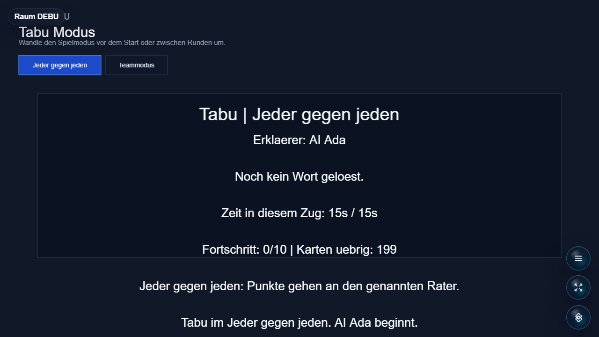

<!-- Modified for LAN Party Hub; see CHANGES.md and NOTICE.md. -->
# Buzzwort

Fast-paced word explanation party game: describe the term without saying any of the blocked words while a watcher listens in.



## Status

Alpha. The explanation and scoring loop is playable in Simplified Chinese, English, and German. The Simplified Chinese deck contains 120 independently drafted cards. Existing upstream English and German word lists still need a separate rights review before public store or commercial distribution.

## Simplified Chinese Support

When the Platform room language is `zh-CN`, the server selects the Chinese card deck and all game-owned Host and Controller copy is rendered in Simplified Chinese. The game ID, package name, protocol fields, and input types remain `buzzwort` for compatibility.

The Chinese deck has 12 cards in each of the ten existing content categories. Every card has five forbidden terms, and the overall difficulty distribution is 50 easy, 50 medium, and 20 hard cards. Its authorship and review status are documented in [docs/content-provenance.md](docs/content-provenance.md).

## Run Through Open Party Lab

This repo is not a standalone app. Run it through the Open Party Lab platform.

Recommended layout:

```text
Open-Party-Lab/
  local-games/
    buzzwort/
```

From the Platform repo:

```bash
npm install
npm run games:sync-local
npm run dev:all
```

The Platform loads this game only when the repo exists locally and `npm run games:sync-local` links it. Missing optional games are skipped.

## GitHub Metadata

Description:

```text
Fast-paced word explanation party game: describe the term without saying any of the blocked words while a watcher listens in.
```

Suggested topics:

```text
open-party-lab party-game browser-game phaser typescript local-multiplayer word-game
```

## Package Entrypoints

- `@open-party-lab/game-buzzwort/manifest`
- `@open-party-lab/game-buzzwort/protocol`
- `@open-party-lab/game-buzzwort/server`
- `@open-party-lab/game-buzzwort/host`
- `@open-party-lab/game-buzzwort/controller`

The Platform should import only these public entrypoints.

## Development Checks

```bash
npm install
npm run typecheck
npm run build
npm test
npm run pack:dry-run
```

For visual checks, start Open Party Lab, add virtual controllers when needed, and capture host screenshots through a browser.

## License

Code is licensed under the Apache License 2.0. See [LICENSE](LICENSE). LAN Party Hub modifications are summarized in [CHANGES.md](CHANGES.md) and attributed in [NOTICE.md](NOTICE.md).

Assets, generated media, word lists, prompts, and third-party references may need separate rights review before public store distribution.
